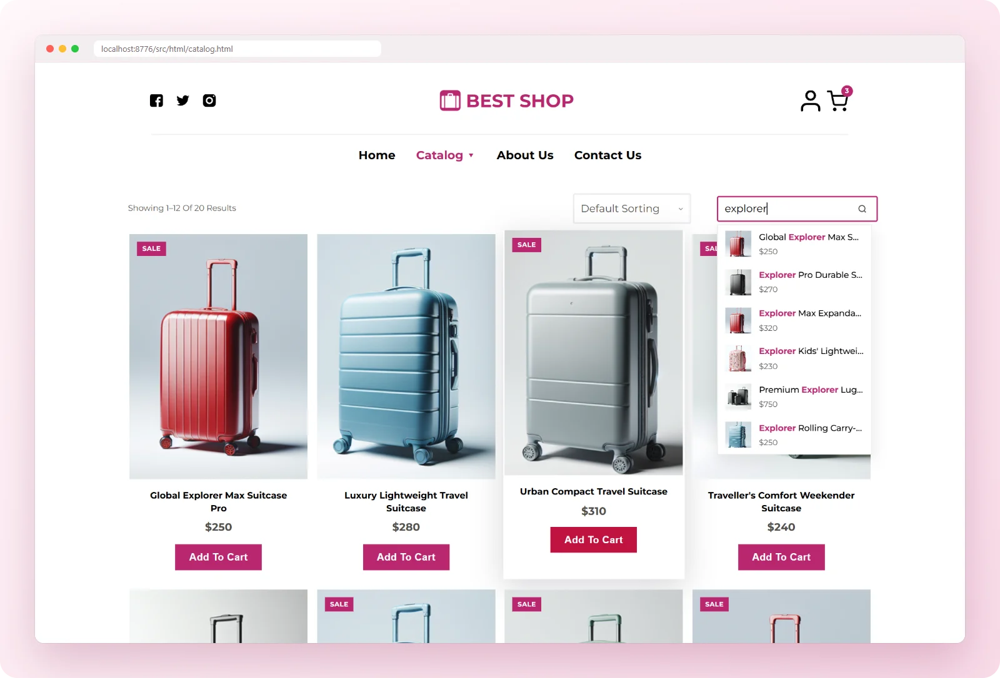
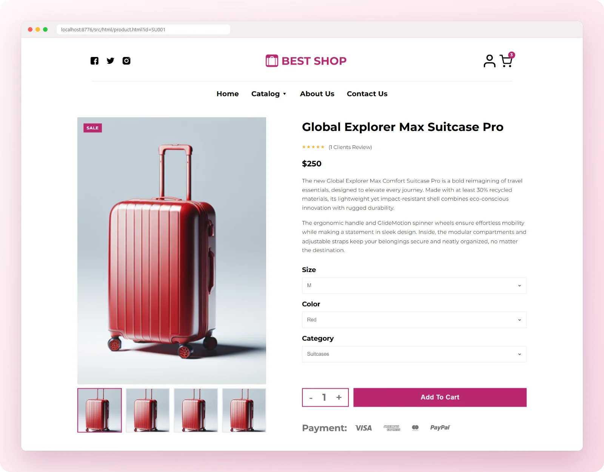
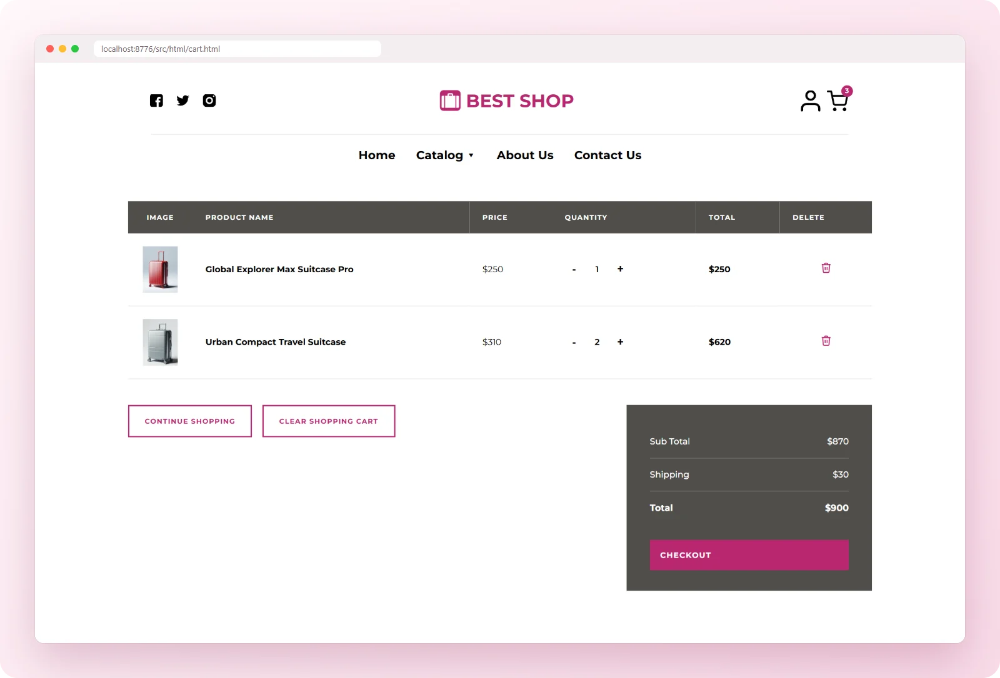

<div align="center">

# 🧳 Best Shop

**A luggage store front end in plain TypeScript and SCSS, with a JSON-driven catalog, live search, product reviews and a localStorage cart.**

Built by a team of two during the EPAM Front-End program.

[](https://www.typescriptlang.org/)
[](https://sass-lang.com/)
[](https://developer.mozilla.org/docs/Web/HTML)
[](#tech-stack)

[Features](#features) · [Screenshots](#screenshots) · [Getting started](#getting-started)

<br>


</div>

## Overview

Best Shop is a multi-page online store for suitcases, luggage sets and kids' luggage. There is no framework and no bundler: each page is a static HTML file that loads one small ES module compiled from TypeScript. Products and reviews come from JSON files, so the whole shop runs from any static file server. The goal was to practise typed, modular vanilla code and a responsive SCSS architecture (abstracts / base / components / layouts / pages).

## Features

<table>
<tr>
<td width="50%" valign="top">

**🛍️ Catalog**
- 20 products loaded from `data.json`, 12 per page with pagination
- Sorting by price (low → high, high → low)
- Live search with a dropdown of up to 6 matches and the query highlighted
- Enter on an exact name jumps straight to the product page
- Category filter through `?category=` in the URL
- "Top Best Sets" sidebar with random luggage sets and star ratings

</td>
<td width="50%" valign="top">

**📦 Product page**
- Product loaded by `?id=`, with SALE badge, rating and price
- Thumbnail gallery, quantity stepper, Add To Cart
- Details / Reviews / Shipping Policy tabs
- Review form with a hover star picker; new reviews are kept in `localStorage`
- "You May Also Like": four random products from the same category

</td>
</tr>
<tr>
<td valign="top">

**🛒 Cart**
- Cart stored in `localStorage`, item count badge in the header on every page
- Change quantity, remove a line, or clear the whole cart
- Subtotal, flat $30 shipping, and a 10% discount from $3,000
- Checkout shows a thank-you state (no payment backend)

</td>
<td valign="top">

**🏠 Home, About and Contact**
- Home renders "Selected Products" (items on sale), a "New Products Arrival" row and the three most recent reviews from JSON
- Contact form with per-field validation (required fields, e-mail format) and a simulated send
- Responsive layout with a hamburger menu under 768 px

</td>
</tr>
</table>

## Screenshots

<div align="center">

**On the phone**: home, catalog and product page


<br><br>

**Catalog with live search**



<br><br>

**Product page**



<br><br>

**Cart**



</div>

## Getting started

Requirements: Node.js (tested with Node 22).

```bash
git clone https://github.com/HHChandar20/bestshop-epam.git
cd bestshop-epam
npm install

# compile once (TypeScript → dist/js, SCSS → dist/css)
npx tsc
npx sass src/scss:dist/css

# or keep both compilers in watch mode while you work
npm run dev
```

The pages load JSON with `fetch`, so open them through a local web server rather than as `file://`. Serve the **repository root** and open `src/index.html`:

```bash
python -m http.server 8080      # any static server works
# then open http://localhost:8080/src/index.html
```

`dist/` is git-ignored, so it has to be compiled after cloning. `npm run build` is only a placeholder for the course's grading tool.

## Project structure

```
src/
├── index.html            Home page
├── html/                 catalog, product, cart, about, contact, login
├── ts/
│   ├── models/           types and enums
│   ├── services/         api.ts, cart.ts
│   ├── pages/            one module per page
│   └── utils/            header menu, toast, stars, shuffle
├── scss/                 abstracts · base · components · layouts · pages
└── assets/               images, data/data.json, data/reviews.json
```

## Tech stack

| Area | Tools |
| --- | --- |
| Language | TypeScript (strict mode, ES modules) |
| Styling | SCSS compiled with Dart Sass, Montserrat from Google Fonts |
| Markup | Static HTML pages, no framework |
| Data | JSON files + browser `localStorage` |
| Dev tooling | `tsc --watch` and `sass --watch` run together with `concurrently` |

## Authors

- Hakan Chandar
- Alexander Baev

<div align="center">
<br>

Built by [Hakan Chandar](https://github.com/HHChandar20) · 2026.

</div>
